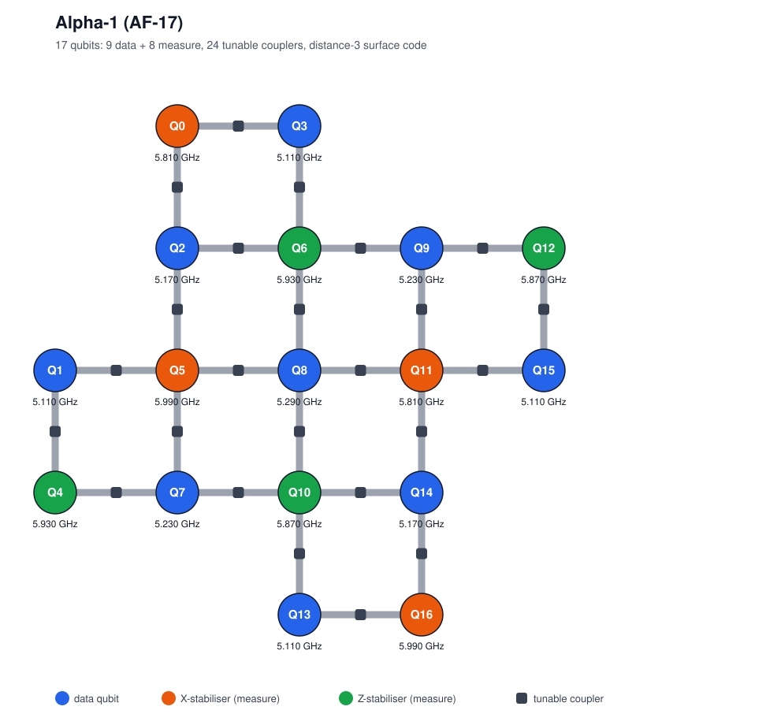

# Alpha-1 (AF-17) — design specification

**Status:** alpha design, frozen 24 Nov 2026. Verified in the qpuforge emulator only: not yet electromagnetically simulated
or fabricated. **Owner:** Secured Cyber Solutions Ltd.

Alpha-1 is the first error-correction-ready processor in the stack: a 17-qubit, distance-3 rotated surface code built from
flux-tunable transmons with tunable couplers. It is designed to demonstrate repeated stabiliser measurement and a protected
logical qubit, using a physics package that, extended to distance 5, is predicted to sit below the surface-code threshold.

| | |
|---|---|
| Qubits | 17 flux-tunable transmons: 9 data, 4 X-stabiliser and 4 Z-stabiliser measure qubits |
| Coupling | 24 tunable couplers, one per data–measure link, parked at zero coupling (≤ 5 kHz residual ZZ) |
| Native gates | virtual RZ · SX / X (25 ns) · CZ (23 ns, \|11⟩↔\|20⟩ via coupler, g_max 40 MHz) · measure (500 ns) · active reset (200 ns) |
| Frequencies | data 5.11–5.29 GHz, measure 5.81–5.99 GHz, anharmonicity −220 MHz, all qubits parked at their flux sweet spot |
| Readout | 17 resonators at 6.90–7.20 GHz on 3 feedlines; κ = 4 MHz, 2χ = κ; one band-pass Purcell filter per feedline |
| Control wiring | 17 XY drive, 17 qubit flux, 24 coupler flux lines; 3 readout feedlines (in + out), one quantum-limited amplifier each |
| QEC cycle | 853 ns per round (two-qubit layers ≈ 150 ns, readout 500 ns, reset 200 ns) |
| **Logical error** | **0.46 % per round** at distance 3 (model) — logical lifetime ≈ 187 µs vs 76 µs best physical T1 |
| Scaling | same physics at distance 5: 0.18 % per round → suppression factor **Λ ≈ 2.6** (below threshold in this model) |
| Fab tolerance | 98 % collision-free chips at 2 % junction-resistance spread, 91 % at 4 % |

Files: `alpha1.json` (machine-readable design for qpuforge), `alpha1_layout.svg` (floor-plan), `alpha1_review.json` (all numbers below).

## 1. Layout and frequency plan

The code is laid out rotated by 45° so every coupler runs horizontally or vertically. CZs only ever connect data and measure
qubits, so the chip has two frequency bands: data qubits low (longer dielectric-limited T1 while they wait through readout)
and measure qubits high (they tune down to the CZ interaction point). Inside each band, qubits use four 60 MHz sub-bands
assigned by colouring a "king's graph". Two qubits of the same type that share a neighbour therefore never sit at the same
frequency, which removes the parasitic and mediated resonances the emulator found in a plain checkerboard.



## 2. Qubit parameters

| Qubit | Role | f01 (GHz) | α (MHz) | E_J/E_C | C_shunt (fF) | R_n (kΩ) | T1 (µs) | T2 (µs) | Readout f (GHz) | Feedline |
|---|---|---|---|---|---|---|---|---|---|---|
| Q0 | measure-X | 5.810 | -220 | 111 | 95.7 | 6.26 | 67 | 64 | 6.90 | 1 |
| Q1 | data | 5.110 | -220 | 89 | 96.8 | 7.93 | 75 | 68 | 6.90 | 2 |
| Q2 | data | 5.170 | -220 | 91 | 96.6 | 7.76 | 75 | 72 | 7.02 | 1 |
| Q3 | data | 5.110 | -220 | 89 | 96.8 | 7.93 | 75 | 70 | 6.96 | 1 |
| Q4 | measure-Z | 5.930 | -220 | 115 | 95.5 | 6.03 | 66 | 74 | 7.20 | 2 |
| Q5 | measure-X | 5.990 | -220 | 117 | 95.1 | 5.92 | 65 | 65 | 6.96 | 2 |
| Q6 | measure-Z | 5.930 | -220 | 115 | 95.2 | 6.03 | 66 | 70 | 7.08 | 1 |
| Q7 | data | 5.230 | -220 | 92 | 96.5 | 7.60 | 74 | 67 | 6.90 | 3 |
| Q8 | data | 5.290 | -220 | 94 | 96.2 | 7.44 | 73 | 72 | 7.02 | 2 |
| Q9 | data | 5.230 | -220 | 92 | 96.4 | 7.60 | 74 | 77 | 7.14 | 1 |
| Q10 | measure-Z | 5.870 | -220 | 113 | 95.3 | 6.14 | 66 | 66 | 6.96 | 3 |
| Q11 | measure-X | 5.810 | -220 | 111 | 95.4 | 6.26 | 67 | 71 | 7.08 | 2 |
| Q12 | measure-Z | 5.870 | -220 | 113 | 95.6 | 6.14 | 67 | 75 | 7.20 | 1 |
| Q13 | data | 5.110 | -220 | 89 | 96.8 | 7.93 | 76 | 75 | 7.08 | 3 |
| Q14 | data | 5.170 | -220 | 91 | 96.6 | 7.76 | 75 | 72 | 7.02 | 3 |
| Q15 | data | 5.110 | -220 | 89 | 96.8 | 7.93 | 76 | 77 | 7.14 | 2 |
| Q16 | measure-X | 5.990 | -220 | 117 | 95.4 | 5.92 | 65 | 72 | 7.14 | 3 |

Common to all qubits: coupling capacitance 0.14 fF per link (bare g = 4 MHz, cancelled by the coupler at idle). Readout
coupling 102–204 MHz, chosen per qubit so that 2χ = κ = 4 MHz. Junctions are Al/AlOx with gap Δ = 180 µeV. Dielectric quality
factor Q = 3 × 10⁶. Effective temperature 45 mK. 1/f flux noise 2 µΦ₀.

Predicted physical errors: single-qubit gate 2.8 × 10⁻⁴, CZ 2.4 × 10⁻³ (2.0 × 10⁻³ calibration-level control error plus
decoherence), readout P(0|1) ≈ 0.85 % and P(1|0) 0.5 %, reset 0.3 %. The CZ interaction is solved at the tuned EJ, where |alpha| is about 222 MHz rather than the idle 220 MHz. Those interaction points need 299–658 MHz of flux
excursion on the measure qubits. The device analysis flags no frequency collisions on any of the 24 links.

## 3. Design decisions and the evidence for them

Each step was emulated as a distance-3 memory experiment (Pauli-frame Monte Carlo, 100,000 shots for each of 2, 4, 6, 8
and 10 rounds). The table gives the logical error per round.

| Design step | Logical error / round | Round time |
|---|---|---|
| Gen-0: fixed capacitive coupling g = 3 MHz (best of the 3×3 sweep), 800 ns readout, measurement-based reset | 1.23 % | 1907 ns |
| + tunable couplers (CZ 187 → 23 ns, idle ZZ 29 → 5 kHz) | 0.54 % | 1253 ns |
| + fast readout with Purcell filtering (500 ns, κ = 4 MHz) | 0.54 % | 953 ns |
| + active reset (200 ns, 0.3 % error) = **Alpha-1** | **0.45 %** | **853 ns** |

* **Tunable couplers** are the decisive change. With a fixed coupling, CZ speed and always-on ZZ crosstalk trade against each
  other, and no fixed g escapes that.
* **Fast readout** removes 300 ns per round, but the stronger resonator coupling lets thermal photons dephase the qubits
  (T2 drops to ≈ T1). The two effects cancel at 45 mK. Fast readout only pays off together with colder lines (see §5).
* **Active reset** removes 100 ns per round and lowers reset error from 1 % to 0.3 %.
* Exact-statevector cross-checks (2 rounds, 300 shots) agree with the fast model for Alpha-1 (P_L 0.67 ± 0.47 % vs 0.78 %).
  For Gen-0 the exact model gives a *worse* result (4.3 ± 1.2 % vs 2.5 %), because coherent ZZ adds up beyond what the Pauli
  model captures. The improvement from Gen-0 to Alpha-1 is therefore if anything understated.

## 4. Error budget for the QEC cycle

Two views, because at distance 3 a logical failure needs two faults, usually from different sources:

| Source | Share of detection events | Logical error if this source were eliminated |
|---|---|---|
| Energy relaxation (T1) | 24.9 % | 0.15 % (−68 %) |
| Gate control errors (mostly CZ) | 31.8 % | 0.17 % (−62 %) |
| Dephasing (T_φ, mostly thermal photons in the fast readout resonators) | 8.4 % | 0.34 % (−25 %) |
| Readout assignment errors | 22.1 % | 0.38 % (−18 %) |
| Reset errors | 12.6 % | 0.40 % (−13 %) |
| Residual coupler ZZ | 0.2 % | 0.45 % (−0 %) |
| Thermal excitation | 0.0 % | 0.46 % (0 %) |

T1 and CZ errors dominate. Each would remove about two thirds of Alpha-1's logical errors if it could be eliminated, far more
than its share of detection events suggests, because most logical failures pair one of them with a second fault.

## 5. What to change for Beta-1 (sensitivity)

One change at a time from Alpha-1 (logical error per round, d = 3):

| Change | Logical error | Effect |
|---|---|---|
| CZ control error 0.20 % → 0.10 % | 0.32 % | −30 % |
| Dielectric Q 3 × 10⁶ → 6 × 10⁶ (T1 × 2) | 0.32 % | −29 % |
| Readout 500 → 300 ns | 0.35 % | −23 % |
| Colder readout/qubit environment, T_eff 45 → 35 mK | 0.36 % | −22 % |
| Readout separation error 0.5 % → 0.25 % | 0.42 % | −7 % |
| Reset error 0.3 % → 0.15 % | 0.43 % | −5 % |
| Single-qubit error 0.01 % → 0.005 % | 0.44 % | −4 % |
| Residual coupler ZZ 5 → 1 kHz | 0.46 % | 0 % |

The next revision should spend its effort on CZ calibration and leakage control, materials and surface treatment for T1,
and faster readout combined with better attenuation and filtering of the readout lines. Shaving residual ZZ below 5 kHz buys
nothing.

## 6. Scaling: is the physics below threshold?

The same design extended to distance 5 (49 qubits, `qpuforge new d5.json --preset alpha1 --distance 5`) gives 0.18 % per
round, against 0.46 % at distance 3. That is a suppression factor Λ = ε₃ / ε₅ ≈ 2.6. In this model, growing the code
therefore keeps reducing the logical error. Treat Λ as an optimistic upper bound (see §8).

## 7. Fabrication tolerance

A Monte Carlo over junction-resistance spread (200 chips per point) re-runs the full device analysis and collision rules for
every chip: 98 % collision-free at 1 % and at 2 % spread, 91 % at 4 %. Junction reproducibility around 2 % (or post-fab
frequency trimming) is enough for Alpha-1's frequency plan.

## 8. What the emulator does not capture yet — read before trusting the numbers

* **Leakage** to |2⟩ during CZ is not simulated. It is folded into the 0.2 % CZ control error, and leakage that persists across
  rounds is a major error source on real surface-code chips.
* **Correlated and time-varying errors:** TLS defects drifting in frequency, quasiparticle bursts and cosmic rays,
  measurement-induced dephasing of neighbours, readout crosstalk, flux crosstalk between lines.
* **Flux-pulse dephasing:** measure qubits leave their sweet spot by up to 660 MHz during CZ, and the extra dephasing during
  those excursions is not modelled.
* **Layout electromagnetics:** capacitances come from the lumped model and the inverse design, not from an EM solve of a real
  layout. Box modes, slotline modes and spurious couplings are absent.
* **Pauli-frame approximation:** validated against exact statevector trajectories (amplitude damping, readout, reset, control
  noise all agree within statistics). Strong coherent ZZ is under-counted, which is negligible at Alpha-1's 5 kHz residual.
* The decoder is minimum-weight matching on the circuit's own detector error model. It is exact for d = 3 and 5 here, and was
  verified to correct every single fault (d = 3) and every pair of faults sampled (d = 5).

On published hardware these effects typically cost a factor of about 1.5–3 in logical error, so read 0.46 % as a best case.

## 9. Path to tape-out

1. **Layout & EM:** draw the GDS (KLayout / Qiskit Metal), then extract the capacitance matrix, participation ratios and
   coupler parameters with an EM solver (e.g. AWS Palace or Ansys Q3D). Feed those back into `alpha1.json` and re-run this
   review.
2. **Coupler and CZ at pulse level:** model the tunable coupler as a third transmon, design the CZ flux pulses, and quantify
   leakage. Add leakage-reduction steps if needed.
3. **Readout chain:** design the Purcell filters and resonator/feedline geometry. Budget amplifiers and attenuation to reach
   the colder effective temperature that §5 shows is worth about 20 %.
4. **Fab process:** base layer (Ta or Nb on sapphire or high-resistivity Si for higher Q), Al/AlOx junctions (Dolan or
   Manhattan), airbridges over the coupler and flux lines, junction-resistance test structures to track spread.
5. **Cryo & wiring:** 58 control lines plus 3 readout chains. Plan flux-line filtering and the fridge wiring budget.
6. **Calibration plan:** frequency tune-up, coupler zero-coupling points, CZ calibration, readout discrimination, reset
   tune-up, then the repeated-round memory experiment that this review predicts.

## Reproducing this review

```bash
cmake -B build -DCMAKE_BUILD_TYPE=Release && cmake --build build -j
./build/qpuforge new alpha1.json --preset alpha1          # regenerate the design
./build/qpuforge analyze alpha1.json                      # device report
./build/qpuforge qec alpha1.json --statevector 300        # logical error per round (+ exact cross-check)
./build/qpuforge layout alpha1.json alpha1_layout.svg
./build/alpha1_review                                     # everything in this document (≈ 7 min on 2 cores)
```
