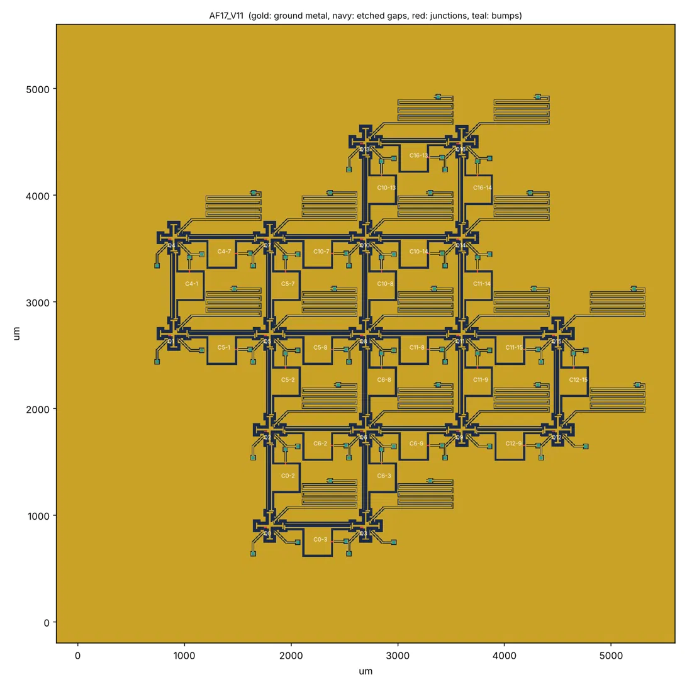
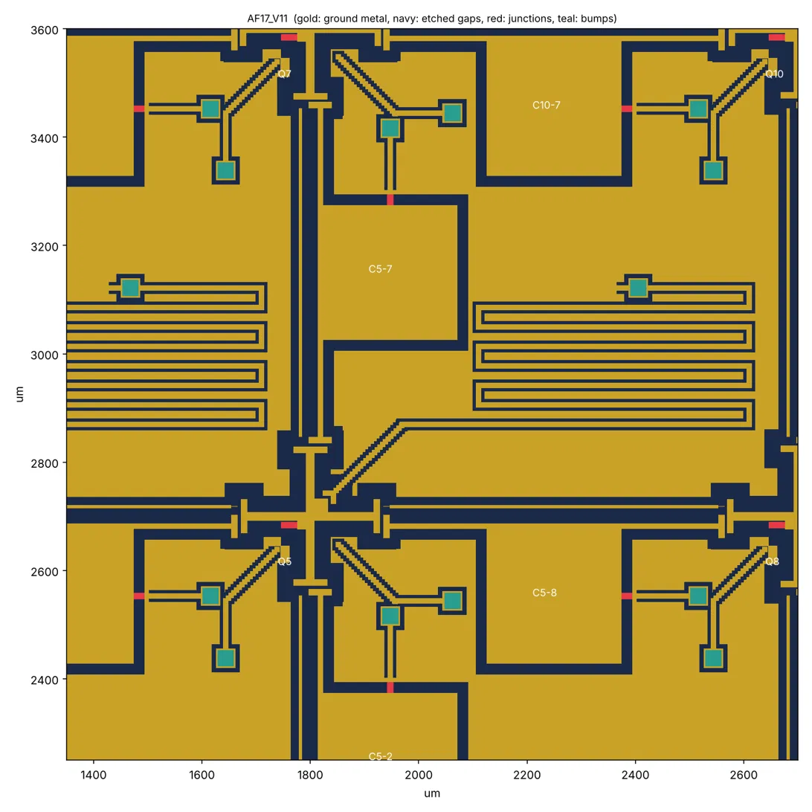
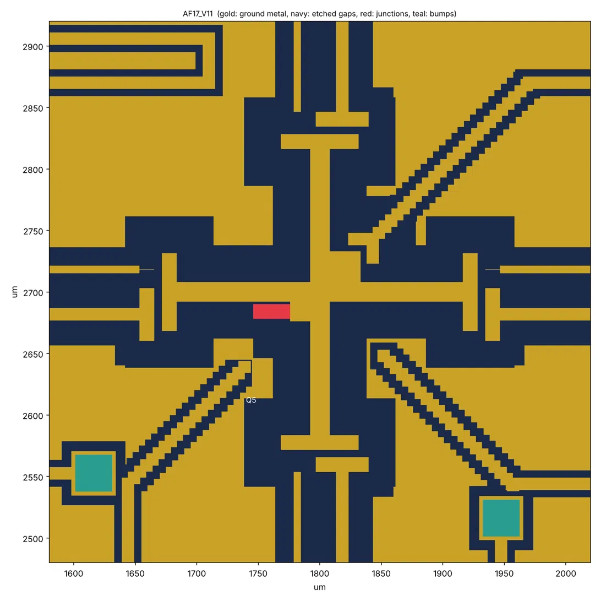

# Transmon anharmonicity and the Alpha-1 processor

Finnian Bond
Secured Cyber Solutions Ltd
25 November 2026

## Abstract

Alpha-1 (AF-17) is a 17-qubit distance-3 surface-code design. It has not been fabricated. This note records the junction physics the design actually uses, the correction that the |11⟩–|20⟩ frequency must be solved at the tuned Josephson energy, and the AF17.V11 metal layout. Every error rate quoted here is from the qpuforge emulator in this repository, not from a device.

## The junction

A superconducting tunnel junction is two condensates separated by a barrier thin enough for Cooper pairs to tunnel. On this design the barrier is aluminium oxide, with gap Δ = 180 µeV. The phase difference φ obeys

I = Ic sin φ,    dφ/dt = 2eV / ℏ.

The energy stored in the junction is EJ (1 − cos φ), with EJ = ℏ Ic / (2e). At zero temperature the Ambegaokar–Baratoff relation fixes Ic from the normal-state resistance Rn of the same barrier. For Rn = 10 kΩ and Δ = 180 µeV the code returns EJ/h = 14.04 GHz, matching the hand calculation. Junction spread is therefore Rn spread, which is what the fabrication Monte Carlo perturbs.

The island also has a charging energy EC = e² / (2C). The Hamiltonian, in frequency units, is

H = 4 EC n² − EJ cos φ.

Alpha-1 parks every transmon at the flux sweet spot of its SQUID, where the first derivative of EJ with respect to flux is zero.

## Anharmonicity is not −EC

Expanding the cosine gives a harmonic oscillator at the plasma frequency ωp = √(8 EJ EC), plus a negative φ⁴ perturbation. First order in that perturbation produces the textbook result

f01 ≈ ωp − EC,    α ≡ f12 − f01 ≈ −EC.

The φ⁶ term and the second-order action of φ⁴ do not cancel. The exact charge-basis spectrum is softer. Scaling EC so that the exact f01 matches the Alpha-1 table gives:

| EJ/EC | f01 (GHz) | EC (MHz) | α exact (MHz) | −EC (MHz) | f23 − f12 (MHz) | f01 charge dispersion |
|------:|----------:|---------:|--------------:|----------:|----------------:|----------------------:|
| 89 | 5.110 | 199 | −220 | −199 | −238 | 21 Hz |
| 94 | 5.290 | 201 | −220 | −201 | −238 | 11 Hz |
| 111 | 5.810 | 202 | −220 | −202 | −235 | 1.3 Hz |
| 117 | 5.990 | 203 | −220 | −203 | −235 | 0.6 Hz |

The −220 MHz written into the design file is this exact α, to about 1 MHz. The shunt capacitances sit near 96–97 fF because that is the C whose charging energy, once the full capacitance matrix is inverted, produces it. Rn is what moves f01. Charge dispersion of f01 is hertz, not megahertz: these ratios are in the transmon regime.

The charge matrix element |⟨0|n|1⟩| at EJ/EC = 89 is 1.27. The large-EJ/EC asymptotic (EJ / 32 EC)^(1/4) is 1.29.

The next spacing is not the same α. f23 − f12 is about −235 MHz. A leakage-reduction pulse that assumes equal Kerr spacings is already wrong by that amount.

## The CZ point moves when the qubit is tuned

The gate used here brings |11⟩ into resonance with |20⟩ of the higher-frequency qubit:

f_tuned + α(EJ_tuned) = f_partner.

α depends on EJ. The idle value is the wrong one to subtract, because |α| grows as the measure qubit is tuned down. The right point is the solution of that equation in the same charge basis as the idle spectrum. **The `analyze()` in this release does not solve it yet:** it still uses the idle-α estimate `f_partner − α_idle` (`include/qpuforge/device.hpp`, `cz_interaction_GHz`). The worked example below is a standalone charge-basis check, not a library function. Moving the solve into `analyze()` is proposed separately (branch `fix/cz-tuned-alpha-solve`).

For EC/h = 200 MHz and an idle frequency of 5.90 GHz, idle α is −217 MHz and the idle-alpha estimate of the interaction is 5.417 GHz. The solved point is 5.419 GHz, where α is −219 MHz. The idle estimate sits about 2 MHz low, so the flux excursion it implies is about 2 MHz too long. On Alpha-1, `analyze()` reports excursions of 300–660 MHz, which carry that offset; solving at the tuned α would give 298.9–657.5 MHz (interaction points 1.9–2.5 MHz higher). Either way the device analysis reports no frequency collisions.

While the pair sits on that resonance, |2⟩ is occupied on purpose. The processor emulator in this repository is still two-level. Leakage during the flux pulse is not integrated; it is folded into the 0.2% CZ control error. That is a model limit, not a measured leakage.

## The coupler has to be a circuit

The previous Alpha-1 file parked every coupler at a typed residual of 5 kHz. That number is not what a capacitive three-transmon circuit produces.

With a direct exchange of 4 MHz and a coupler–qubit coupling of 70 MHz, the bias that cancels the exchange (coupler near 4.23 GHz) still leaves −119 kHz of ZZ. Cutting the direct capacitance to 1 MHz, and setting g_qc = 40 MHz with EC/h = 200 MHz, moves the exchange null to 3.88 GHz on a 5.20/5.90 GHz pair and leaves −7 kHz. Across the 24 Alpha-1 links the nulls lie between 3.787 and 3.967 GHz and the idle ZZ lies between −4.3 and −13.8 kHz. Each coupler junction is sized so that null is its flux sweet spot. The 23 ns gate still takes g_max = 40 MHz from a separate on-state bias. This diagonalisation is three levels on each island. It is not an electromagnetic extract of the AF17.V11 polygons.

## Flux noise during the 23 ns gate

Idle dephasing uses the sweet spot, where df/dΦ is zero and only the second derivative of frequency survives. The CZ does not happen there. On a 5.90 GHz qubit tuned onto a 5.20 GHz partner the gate sits at 0.177 Φ₀, where df/dΦ is −5.5 GHz/Φ₀.

The same 1/f spectrum as the idle model (A = 2 µΦ₀, S_Φ(f) = A²/|f|) then gives a short-time infidelity of 3.2×10⁻⁵ for that pair, and 2.0–4.6×10⁻⁵ across Alpha-1. Phase variance grows as t², so treating the dephasing rate as Markovian and multiplying by 23 ns would overstate the error by about two orders of magnitude. The reported CZ error is 2.43×10⁻³, still the 2.0×10⁻³ control allocation plus decoherence plus this term. The logical-error table below was not recomputed.

## Alpha-1

Alpha-1 is a rotated distance-3 surface code: 9 data qubits and 8 measure qubits, 24 tunable couplers, three readout feedlines. Data qubits idle at 5.11–5.29 GHz and measure qubits at 5.81–5.99 GHz, all at −220 MHz anharmonicity. Readout is 500 ns with κ = 4 MHz. The round, including a 200 ns active reset, is 853 ns.

The committed review (`designs/alpha1/alpha1_review.txt`), a Pauli-frame memory experiment, reports:

| Step | Logical error per round | Round |
|---|---:|---:|
| Fixed coupling, g = 3 MHz, 800 ns readout | 1.23% | 1907 ns |
| Tunable couplers | 0.54% | 1253 ns |
| Fast Purcell-filtered readout | 0.54% | 953 ns |
| Active reset (Alpha-1) | 0.45% | 853 ns |

The same physics at distance 5 gives 0.18% per round in that model, a suppression factor of about 2.6. A Monte Carlo of junction resistance gives a collision-free yield of 98% at 2% spread and 91% at 4%. The logical lifetime in the review is about 187 µs against a best physical T1 of 76 µs.

These are emulator outputs. The review itself lists what is missing: leakage across rounds, quasiparticles, cosmic rays, flux-pulse dephasing, and a real electromagnetic extract. On published hardware those effects commonly cost a factor of about 1.5–3 in logical error, so 0.45% is a best case of this model.

## The AF17.V11 layout

The metal layout is a separate drawing from the lumped floor-plan. AF17.V11 plots the ground plane in gold, etched gaps in navy, junctions in red, and bump pads in teal. The axes run to about 5.5 mm. It is not a photograph and not a measured chip.



The centre of the die, qubits Q5, Q7, Q8 and Q10:



Q5, one junction and two bump pads:



The lumped model does not read this drawing back. Capacitances in `alpha1.json` come from the inverse design, not from an electromagnetic solve of these polygons. A full-wave extract of AF17.V11, fed back into `alpha1.json`, is the next design step. Until that extract exists, the layout and the error rates are two consistent intentions, not one closed loop.

## Reproducing the numbers in this note

```bash
cmake -B build -DCMAKE_BUILD_TYPE=Release && cmake --build build -j
./build/test_qpuforge
./build/qpuforge analyze examples/alpha1.json
```

The anharmonicity table above is the charge-basis diagonalisation at the EJ/EC ratios in `designs/alpha1/ALPHA-1.md`. The logical-error table is `designs/alpha1/alpha1_review.txt`. The excursion range is `analyze`, which uses the idle-α estimate (see above); the tuned-α worked example is a standalone diagonalisation of H = 4 EC n² − EJ cos φ.

## Licence

Software, design files and this note belong to Secured Cyber Solutions Ltd. All rights reserved. Third-party interatomic-potential parameters used by atomforge, if present alongside this repository, keep their own licence.
